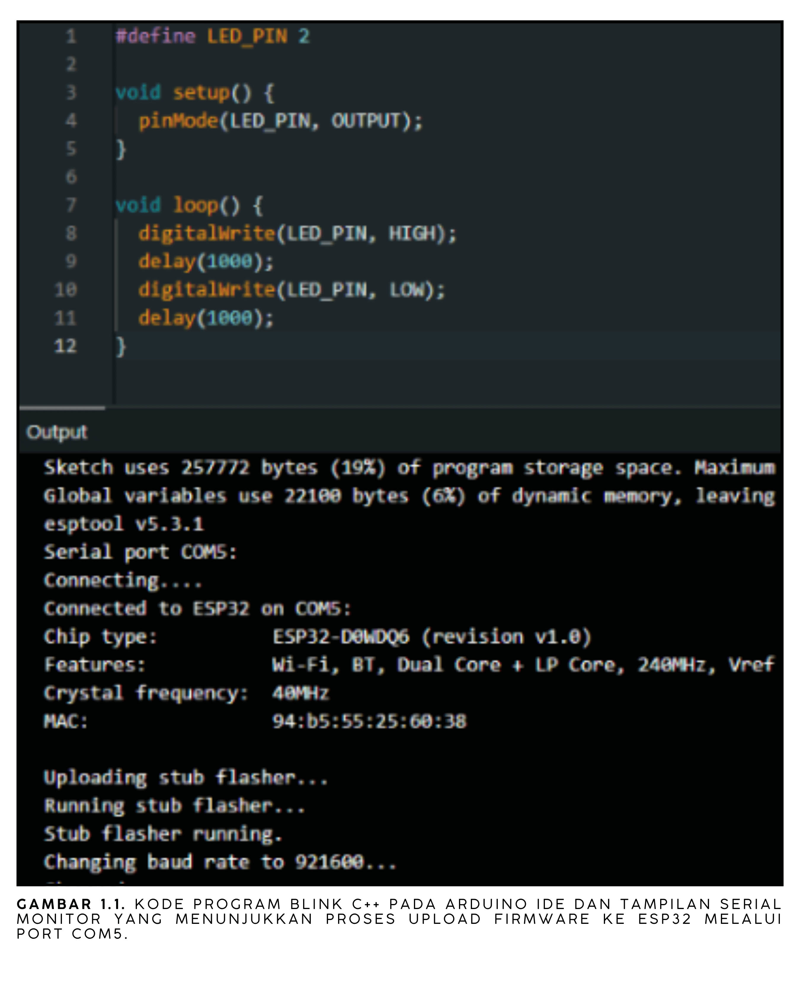
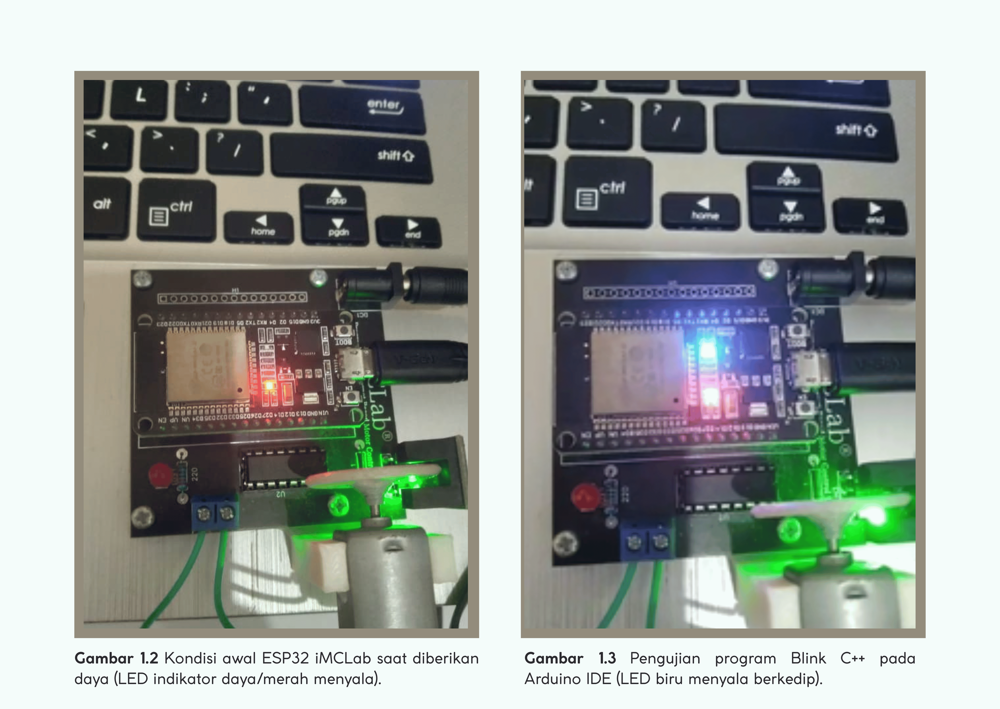

# Pemrograman Basic Robotika dengan Kit iMCLab

**Laporan Riset Modul 1** Dasar ESP32 dan pemrograman C++ di Arduino IDE.

## 1. Ringkasan Riset

Eksperimen pertama memperkenalkan ESP32 pada kit iMCLab dan alur kerja dasar Arduino IDE: menulis program C++, memilih board dan port, mengunggah firmware, lalu mengamati hasilnya. Program yang dibuat adalah *Blink*, yaitu menyalakan dan mematikan LED internal ESP32 (GPIO 2) setiap 1 detik. Tangkapan layar membuktikan kode berhasil dikompilasi dan diunggah melalui port `COM5`; perilaku LED yang berkedip terlihat pada video percobaan.

## 2. Tujuan

1. Mengenal struktur program Arduino (`setup()` dan `loop()`).
2. Mengontrol keluaran digital ESP32 untuk menyalakan LED.
3. Menguji rantai kerja *write → compile → upload → observe* pada ESP32.

## 3. Alat dan Parameter

| Komponen / parameter | Konfigurasi |
| --- | --- |
| Perangkat | ESP32 pada kit iMCLab, kabel USB |
| Perangkat lunak | Arduino IDE |
| Port | `COM5` |
| Pin LED | GPIO 2 (LED internal) |
| Interval | 1.000 ms ON, 1.000 ms OFF |
| Program | [Modul_1_Basic.ino](Modul_1_Basic.ino) |

## 4. Dasar Kerja

```cpp
#define LED_PIN 2

void setup() { pinMode(LED_PIN, OUTPUT); }

void loop() {
  digitalWrite(LED_PIN, HIGH); delay(1000);
  digitalWrite(LED_PIN, LOW);  delay(1000);
}
```

`setup()` berjalan sekali untuk mengatur GPIO 2 sebagai output. `loop()` berulang tanpa henti sehingga LED berkedip dengan periode 2 detik (0,5 Hz) dan duty cycle 50%.

## 5. Langkah Percobaan

1. Menyambungkan ESP32 ke komputer melalui kabel USB.
2. Memilih board ESP32 dan port `COM5` pada Arduino IDE.
3. Menulis kode Blink, lalu menekan **Upload**.
4. Menunggu proses unggah selesai, kemudian mengamati LED pada board.

## 6. Hasil dan Dokumentasi



*Gambar 1.1. Kode program Blink C++ pada Arduino IDE dan tampilan proses upload firmware ke ESP32 melalui port COM5.*



*Gambar 1.2. Dokumentasi lanjutan program Blink dan proses upload firmware ke ESP32 melalui port COM5.*

**Analisis:** Kedua gambar menunjukkan bahwa kode sesuai dengan program di atas dan bahwa unggahan menuju `COM5` berjalan, sehingga driver USB, pemilihan board, dan toolchain sudah berfungsi. Kedipan LED dibuktikan melalui video, bukan melalui gambar statis.

## 7. Analisis dan Keterbatasan

- Fungsi `delay()` bersifat *blocking*: selama menunggu, ESP32 tidak mengerjakan hal lain. Ini cukup untuk Blink, tetapi program yang juga membaca serial atau jaringan (Modul 2–4) perlu pendekatan yang tidak memblokir.
- Program tidak memakai Serial, sehingga tidak ada keluaran teks untuk diverifikasi selain kondisi LED.
- Interval 1 detik belum diukur dengan alat; nilainya berasal dari kode.

## 8. Kesimpulan

Modul 1 berhasil memastikan lingkungan Arduino IDE dan ESP32 iMCLab siap dipakai: kode dikompilasi, diunggah melalui `COM5`, dan menggerakkan keluaran digital GPIO 2. Fondasi ini dipakai pada modul berikutnya.

## 9. Dokumentasi Video

[Video percobaan Modul 1](https://drive.google.com/file/d/1WdCEDa_vej9XmxmCjt_KVqi2V4ev1Voe/view?usp=drive_link)
