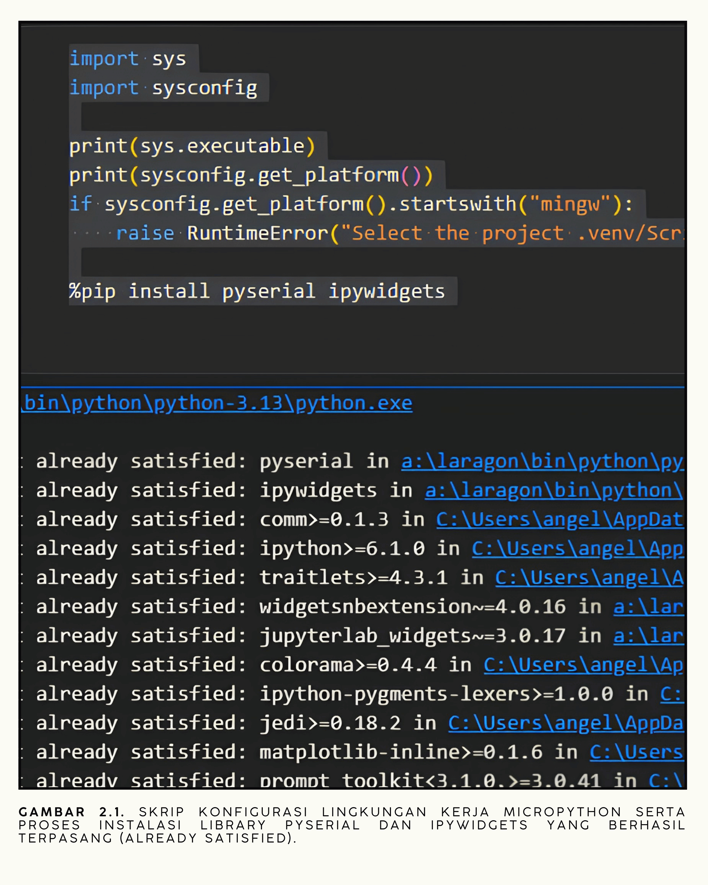
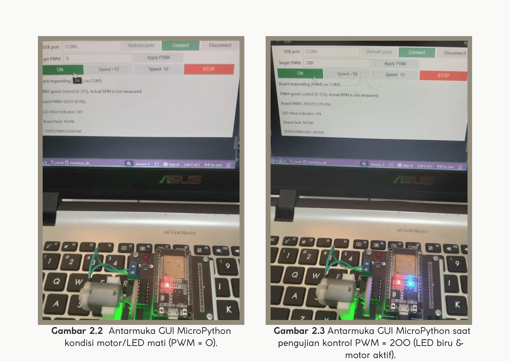

# Pemrograman Robotika dengan Kit iMCLab Menggunakan Python

**Laporan Riset Modul 2** Antarmuka Python (Jupyter) untuk kendali PWM motor DC dan pembacaan status ESP32 melalui USB serial.

## 1. Ringkasan Riset

Eksperimen ini mengembangkan kendali serial menjadi panel interaktif berbasis Python di Jupyter Notebook. Pengguna memilih port USB, mengatur nilai PWM (0–255), menaikkan/menurunkan kecepatan, dan menekan STOP. ESP32 membalas dengan paket status yang ditampilkan pada panel, sehingga nilai **perintah** pengguna dapat dibedakan dari nilai **keluaran yang dilaporkan board**. Firmware juga menghentikan keluaran otomatis bila perintah berhenti datang selama 2 detik.

## 2. Tujuan dan Pertanyaan Riset

1. Bagaimana Python mengirim nilai PWM dan menampilkan balasan ESP32?
2. Informasi apa yang dapat dipercaya dari status pada panel?
3. Bagaimana program menangani terhentinya aliran perintah?

## 3. Dasar Kerja Sistem

```text
Panel ipywidgets (Jupyter)
        | target PWM melalui antrean
        v
Thread komunikasi Python / pyserial
        | "PWM:<nilai>\n" setiap 0,5 detik
        v
      ESP32 ------> LED dan penggerak motor DC
        |
        `-- STATE,PWM,<duty>,<led>,<fault> --> panel status
```

Persentase pada panel dihitung `nilai / 255 × 100%`. Nilai ini adalah perintah keluaran firmware, **bukan** pembacaan RPM; tidak ada sensor putaran pada percobaan ini.

## 4. Alat dan Parameter

| Komponen / parameter | Konfigurasi |
| --- | --- |
| Perangkat | ESP32, kit iMCLab, penggerak dan motor DC, kabel USB |
| Antarmuka | [Modul_Python.ipynb](Modul_Python.ipynb) |
| Program board | [Modul_2_Python.ino](Modul_2_Python.ino) |
| Pustaka Python | `pyserial` 3.5, `ipywidgets` 8.1.9 (Python 3.13, `win-amd64`, sesuai keluaran notebook) |
| LED / arah motor / enable | GPIO 2 / GPIO 27 dan 26 / GPIO 12 |
| Serial | 115.200 baud |
| PWM | 30 kHz, resolusi 8 bit, rentang 0–255 |
| Nilai ON bawaan / langkah | 200 (≈ 78,4%) / 10 satuan |
| Pengiriman ulang Python | Setiap 0,5 detik |
| Timeout firmware | 2.000 ms sejak perintah valid terakhir (jika PWM > 0) |

## 5. Langkah Percobaan

1. Mengunggah `Modul_2_Python.ino` ke ESP32, lalu menutup Serial Monitor agar port bebas.
2. Menjalankan sel pertama notebook (cek lingkungan dan instalasi `pyserial`, `ipywidgets`).
3. Menjalankan sel kedua untuk menampilkan panel, memilih port (mis. `COM5`), lalu **Connect**.
4. Menunggu balasan board; kontrol PWM baru aktif setelah board melaporkan status `NONE`.
5. Mengatur **Target PWM** → **Apply PWM**, atau memakai **ON**, **Speed +10**, **Speed -10**.
6. Membandingkan target dengan **Board PWM**, **LED drive indicator**, dan **Board fault**.
7. Menekan **STOP** (PWM 0), kemudian **Disconnect**.

## 6. Hasil dan Dokumentasi



*Gambar 2.1. Skrip konfigurasi lingkungan kerja Python di Jupyter serta pustaka `pyserial` dan `ipywidgets` yang berhasil terpasang (requirement already satisfied).*



*Gambar 2.2. Dokumentasi lanjutan konfigurasi lingkungan kerja dan instalasi pustaka.*

**Analisis:** Kedua gambar membuktikan lingkungan Python siap: interpreter terdeteksi, dan pustaka serial serta widget tersedia. Bagian ini adalah prasyarat; kemampuan mengatur PWM dan respons motor ditunjukkan pada video percobaan.

## 7. Analisis Implementasi

**Komunikasi dua arah.** Python mengirim perintah absolut seperti `PWM:200`. ESP32 memeriksa format dan rentang, menerapkan keluaran, lalu membalas `STATE,PWM,200,1,NONE`. Panel memperbarui **Board PWM** hanya dari balasan ini. Perintah absolut membuat pengiriman ulang aman: nilai yang sama diulang tidak menambah atau mengurangi PWM.

**Penghentian otomatis.** Jika perintah valid tidak diterima selama 2 detik saat PWM > 0, firmware memanggil `applyMotor(0)` dan menetapkan fault `COMMAND_TIMEOUT`. Perintah positif ditolak sampai nol dikirim (tombol STOP). Selain itu, thread Python mengirim `PWM:0` saat koneksi ditutup.

**Arti indikator.** LED menyala bila `dutyCycle > 0`; ini penanda keluaran aktif, bukan bukti motor berputar. PWM 200 berarti ±78,4% skala, bukan 200 RPM.

## 8. Keterbatasan

- Kecepatan aktual motor, latensi perintah, dan waktu henti fisik setelah timeout tidak diukur.
- Fungsi `applyMotor()` masih memakai batas atas 300 pada `constrain()`, padahal jalur perintah membatasi sampai 255; sebaiknya diseragamkan ke 255.
- Pengujian lanjutan yang disarankan: rekam target vs balasan untuk beberapa nilai PWM, uji putus komunikasi untuk memverifikasi `COMMAND_TIMEOUT`, dan tambahkan sensor RPM.

## 9. Kesimpulan

Panel Python berhasil menghubungkan pengguna dengan ESP32 melalui serial dua arah, memisahkan nilai perintah dari status board, dan menyediakan mekanisme aman berupa timeout 2 detik serta STOP. Kecepatan aktual motor belum terukur.

## 10. Dokumentasi Video

[Video percobaan Modul 2](https://drive.google.com/file/d/1d3ACuxhzjc09Mz-AoaVeqKNPiSfTUFd2/view?usp=drive_link)
