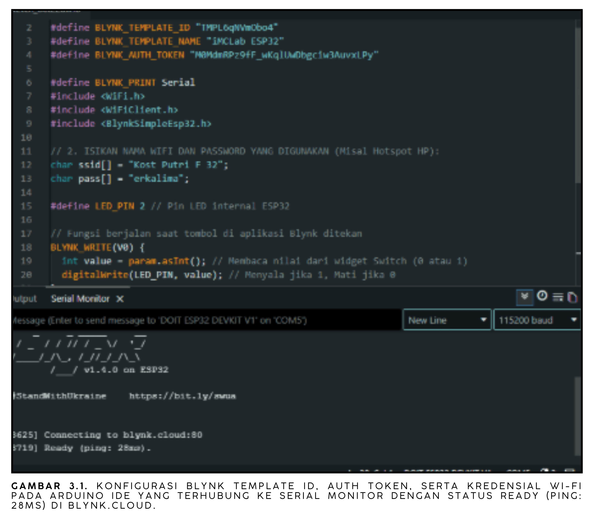
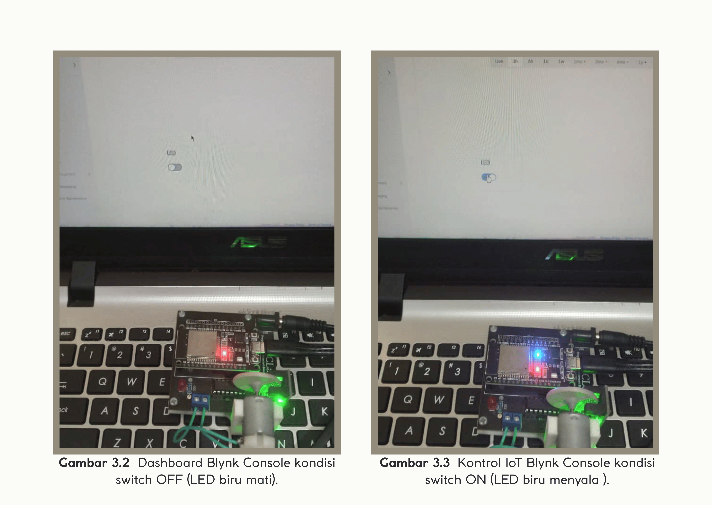

# Pemrograman iMCLab Berbasis Blynk

**Laporan Riset Modul 3** Kendali LED ESP32 dari jarak jauh melalui platform Blynk IoT.

## 1. Ringkasan Riset

Eksperimen ini menghubungkan ESP32 ke Wi-Fi dan ke Blynk Cloud. Sebuah widget *Switch* pada aplikasi/dashboard Blynk terhubung ke *virtual pin* `V0`; saat switch diubah, ESP32 menerima nilai 0 atau 1 dan menyalakan atau mematikan LED internal (GPIO 2). Serial Monitor menunjukkan status `Ready` dengan ping 28 ms ke `blynk.cloud`, yang menandakan koneksi cloud berhasil.

## 2. Tujuan

1. Menyiapkan template dan perangkat pada Blynk Console.
2. Menghubungkan ESP32 ke Wi-Fi dan Blynk memakai Template ID, Auth Token, dan kredensial Wi-Fi.
3. Mengendalikan keluaran digital ESP32 melalui internet.

## 3. Alat dan Parameter

| Komponen / parameter | Konfigurasi |
| --- | --- |
| Perangkat | ESP32 pada kit iMCLab |
| Platform | Blynk IoT (template **iMCLab ESP32**) |
| Pustaka | `WiFi.h`, `BlynkSimpleEsp32.h` |
| Pin kendali | Virtual pin `V0` → GPIO 2 (LED internal) |
| Serial | 115.200 baud (`BLYNK_PRINT Serial`) |
| Program | [Modul_3_Blynk.ino](Modul_3_Blynk.ino) |

## 4. Dasar Kerja

```text
Switch Blynk (V0) --> Blynk Cloud --> Wi-Fi --> ESP32: BLYNK_WRITE(V0)
                                                  digitalWrite(LED_PIN, nilai)
```

`Blynk.begin()` menyambungkan ESP32 ke Wi-Fi dan server. `Blynk.run()` pada `loop()` menjaga koneksi dan memproses data masuk. Fungsi `BLYNK_WRITE(V0)` dipanggil setiap kali nilai `V0` berubah, lalu nilai (0/1) langsung ditulis ke GPIO 2.

## 5. Langkah Percobaan

1. Membuat template pada Blynk Console, menambah datastream `V0` (integer 0–1) dan widget Switch.
2. Membuat perangkat dari template, lalu menyalin `BLYNK_TEMPLATE_ID`, `BLYNK_TEMPLATE_NAME`, dan `BLYNK_AUTH_TOKEN` ke kode.
3. Mengisi SSID dan password Wi-Fi, kemudian mengunggah program ke ESP32.
4. Membuka Serial Monitor dan memastikan ESP32 terhubung ke Blynk.
5. Mengoperasikan Switch pada Blynk dan mengamati LED.

## 6. Hasil dan Dokumentasi



*Gambar 3.1. Konfigurasi Blynk Template ID, Auth Token, dan Wi-Fi pada Arduino IDE, terhubung ke Serial Monitor dengan status Ready (ping: 28 ms) di blynk.cloud.*



*Gambar 3.2. Dokumentasi lanjutan konfigurasi Blynk dan status koneksi ESP32.*

**Analisis:** Status `Ready` menunjukkan autentikasi (template dan token) valid dan Wi-Fi berhasil tersambung. Ping 28 ms adalah waktu tempuh ke server Blynk, bukan total waktu dari klik switch sampai LED berubah. Respons LED terhadap Switch dibuktikan pada video percobaan.

## 7. Analisis dan Keterbatasan

- Kendali bersifat *event-driven*: ESP32 hanya bertindak saat nilai `V0` berubah, jadi `loop()` tetap ringan dan tidak memakai `delay()`.
- Program membutuhkan Wi-Fi saat `Blynk.begin()`; bila jaringan tidak tersedia, program menunggu koneksi.
- Kredensial Wi-Fi dan Auth Token tertulis langsung di kode. Untuk repositori publik, simpan di berkas terpisah yang tidak ikut di-*commit* atau ganti dengan placeholder, dan buat ulang token jika sempat terpublikasi.
- Latensi end-to-end dan keandalan jangka panjang belum diukur.

## 8. Kesimpulan

ESP32 berhasil terhubung ke Wi-Fi dan Blynk Cloud, serta menerima perintah dari virtual pin `V0` untuk mengendalikan LED. Modul ini memindahkan kendali dari kabel USB ke internet.

## 9. Dokumentasi Video

[Video percobaan Modul 3](https://drive.google.com/file/d/1K3BzaF_gilArYSQygdOeBAOoUOWHzmH3/view?usp=drive_link)
