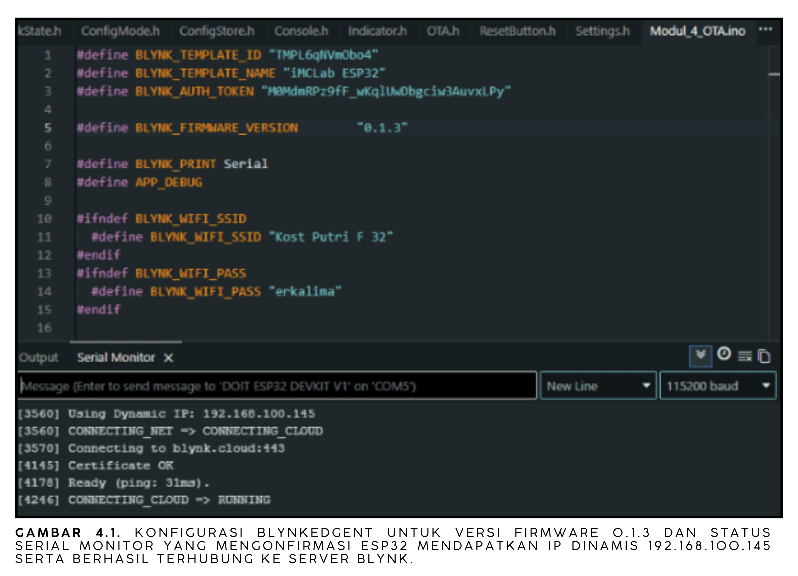
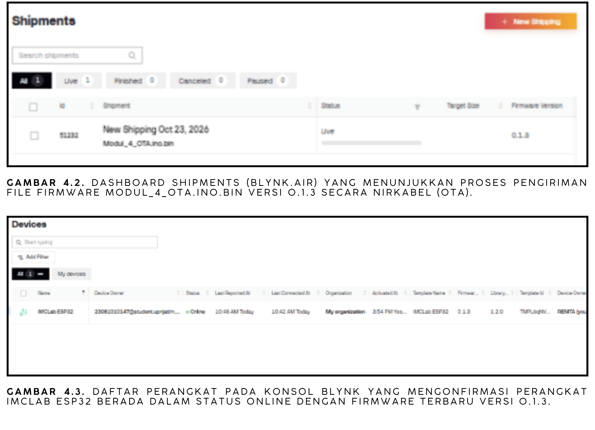
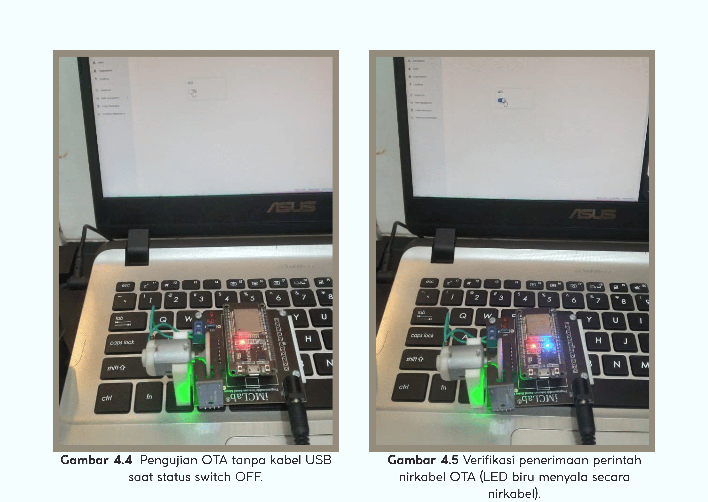

# Pemrograman OTA Berbasis Blynk

**Laporan Riset Modul 4** Pembaruan firmware ESP32 secara nirkabel (*Over-The-Air*) melalui Blynk.Air.

## 1. Ringkasan Riset

Eksperimen ini menambahkan kemampuan OTA: firmware baru dikirim lewat internet ke ESP32 tanpa kabel USB. Program memakai `BlynkEdgent` dengan versi firmware `0.1.3`. Setelah berkas `.bin` hasil kompilasi diunggah ke menu **Shipments** (Blynk.Air), perangkat iMCLab ESP32 tercatat **Online** dengan firmware `0.1.3`, dan Serial Monitor menunjukkan ESP32 mendapat IP dinamis `192.168.100.145` serta terhubung ke server Blynk.

## 2. Tujuan

1. Menyiapkan firmware ber-versi dengan `BlynkEdgent`.
2. Menghasilkan berkas biner dan mengirimkannya melalui Blynk.Air.
3. Memverifikasi versi firmware pada perangkat setelah pembaruan.

## 3. Alat dan Parameter

| Komponen / parameter | Konfigurasi |
| --- | --- |
| Perangkat | ESP32 pada kit iMCLab (board DOIT ESP32 DevKit V1) |
| Platform | Blynk IoT, Blynk.Air (Shipments) |
| Pustaka | `BlynkEdgent` |
| Versi firmware | `0.1.3` (`BLYNK_FIRMWARE_VERSION`) |
| Fungsi program | Virtual pin `V0` → GPIO 2 (LED), seperti Modul 3 |
| Program / biner | [Modul_4_OTA.ino](Modul_4_OTA.ino), biner di folder [build](build/esp32.esp32.esp32doit-devkit-v1/) |

## 4. Dasar Kerja

```text
Arduino IDE --(Export Compiled Binary)--> .bin
     |
     v
Blynk.Air > Shipments --(internet)--> ESP32 (BlynkEdgent) --> menulis firmware, restart
                                                              --> melapor versi 0.1.3
```

Versi pada `BLYNK_FIRMWARE_VERSION` dikirim perangkat ke cloud sehingga Blynk dapat menampilkan versi yang sedang berjalan. Setiap pembaruan sebaiknya menaikkan nomor versi agar dapat dibedakan dari firmware sebelumnya.

## 5. Langkah Percobaan

1. Mengatur Template ID, Template Name, Auth Token, dan `BLYNK_FIRMWARE_VERSION "0.1.3"` pada kode.
2. Mengunggah program awal melalui USB dan memastikan ESP32 terhubung ke Blynk (Serial Monitor).
3. Menghasilkan berkas biner dengan **Sketch → Export Compiled Binary** (tersimpan di folder `build`).
4. Pada Blynk.Air, membuat *shipment* baru, mengunggah berkas `.bin` versi 0.1.3, dan memilih perangkat tujuan.
5. Memulai pengiriman, lalu memantau progresnya pada dashboard **Shipments**.
6. Memeriksa daftar perangkat: status **Online** dan versi firmware terbaru.

## 6. Hasil dan Dokumentasi



*Gambar 4.1. Konfigurasi BlynkEdgent untuk firmware versi 0.1.3 dan Serial Monitor yang mengonfirmasi ESP32 mendapat IP dinamis 192.168.100.145 serta berhasil terhubung ke server Blynk.*



*Gambar 4.2 (atas). Dashboard Shipments (Blynk.Air) yang menunjukkan pengiriman berkas `Modul_4_OTA.ino.bin` versi 0.1.3 secara nirkabel.*
*Gambar 4.3 (bawah). Daftar perangkat pada konsol Blynk: iMCLab ESP32 berstatus Online dengan firmware terbaru versi 0.1.3.*



*Gambar 4.4. Dokumentasi lanjutan konfigurasi BlynkEdgent dan sambungan cloud.*

**Analisis:**

- **Gambar 4.1** membuktikan perangkat terhubung ke jaringan lokal (IP dinamis dari DHCP) dan ke server Blynk sebelum OTA; tanpa koneksi ini OTA tidak dapat berjalan.
- **Gambar 4.2** menunjukkan jalur pembaruan: berkas biner dikirim dari cloud, bukan dari kabel USB.
- **Gambar 4.3** adalah bukti hasil: perangkat Online dengan versi 0.1.3, sesuai nilai `BLYNK_FIRMWARE_VERSION` pada kode.

## 7. Analisis dan Keterbatasan

- Fungsi program tidak berubah dari Modul 3 (kendali LED lewat `V0`); yang baru adalah mekanisme pembaruan dan pelaporan versi.
- IP `192.168.100.145` bersifat dinamis dan dapat berganti pada sesi berikutnya.
- Keberhasilan pembaruan dinilai dari versi terlapor pada Blynk. Perbandingan versi sebelum dan sesudah, serta lamanya proses OTA, perlu dilihat pada video karena tidak tercatat sebagai data tersendiri.
- Kredensial Wi-Fi dan Auth Token berada di kode; jangan dipublikasikan, dan buat ulang token jika sempat terbuka.

## 8. Kesimpulan

Firmware `0.1.3` berhasil dikirim melalui Blynk.Air dan perangkat iMCLab ESP32 tercatat Online dengan versi tersebut. OTA memungkinkan perbaikan atau penambahan fitur pada perangkat tanpa akses fisik.

## 9. Dokumentasi Video

[Video percobaan Modul 4](https://drive.google.com/file/d/11SeQsEzhp6-u1BFO43qM77FLnAYvZPhR/view?usp=drive_link)
